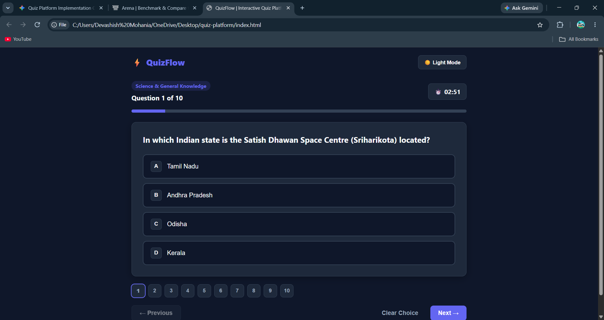
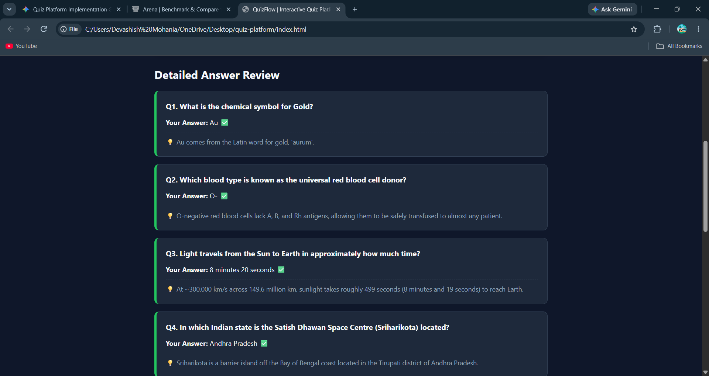

# QuizFlow — Interactive Quiz Platform

Submission for **Problem Statement 2: Quiz Platform** (Software Division Induction, Programming Club, IIT Indore).

## 🚀 Live Demo
https://kaunnaman.github.io/quiz-platform/

## ✨ Features
- **Decoupled Data Architecture:** Quizzes are stored in `questions.js` in a structured schema (`id`, `title`, `questions`, `options`, `answer`, `explanation`). Adding a new quiz requires zero changes to UI or scoring code.
- **Multi-Screen Flow:** Seamless transitions between the Topic Selection screen, Active Quiz view, and Results/Review dashboard.
- **Full Navigation & Question Palette:** Move forward/backward with Next/Previous buttons or jump directly to any question via the interactive question palette.
- **Stretch Goals Implemented:**
  - **Countdown Timer:** Optional 3-minute timer with auto-submission when time expires.
  - **Question Randomisation:** Fisher-Yates shuffle toggle on the start screen.
  - **Persistent Leaderboard:** Stores recent attempts in `localStorage`.
  - **Dark / Light Mode:** Theme preference saved across reloads.

## 🛠️ Tech Stack
- **HTML5:** Semantic layout
- **CSS3:** Custom properties (CSS variables), Flexbox, Grid, responsive design
- **Vanilla JavaScript (ES6+):** Centralized state management, DOM manipulation, `localStorage` API

## 💻 Running Locally
1. Clone the repository:
   ```bash
   git clone [https://github.com/](https://github.com/)kaunnnaman/quiz-platform.git

## 📸 Screenshots
### Start Screen


### Quiz in Progress


### Results


### Answer Review

